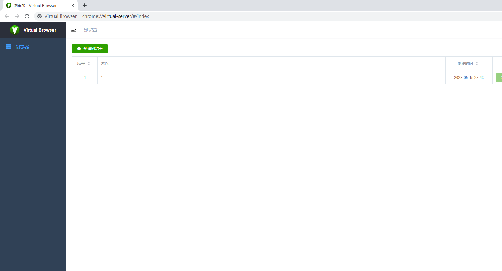
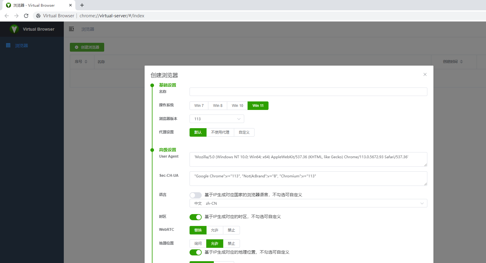
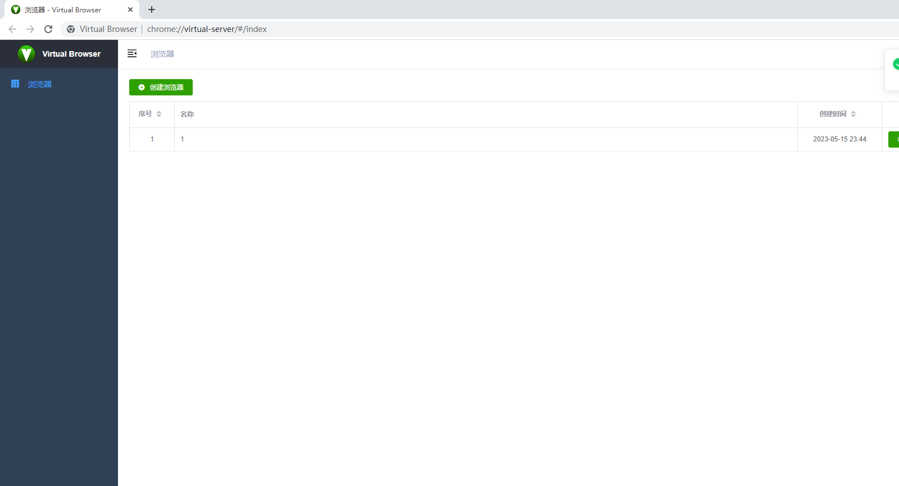

  

<b><a href="README.md">简体中文</a> | <a href="README_EN.md">English</a></b>

# VirtualBrowser

VirtualBrowser 是一款基于 [Chromium](https://www.chromium.org/) 的指纹浏览器，支持 Windows、macOS 和 Linux，可在单台设备上创建并管理多个相互隔离的浏览器环境。

**浏览器指纹**指通过采集浏览器、操作系统与硬件等特征（如 User-Agent、语言、分辨率、字体、Canvas/WebGL 噪声等）生成可用于识别或关联用户的数字签名。VirtualBrowser 帮助你在合规前提下隔离各环境的指纹，降低账号关联与追踪风险。

## 特性

- **多环境隔离**：一台机器上创建多套独立指纹配置
- **集中管理**：统一创建、启动、编辑与删除浏览器环境
- **丰富指纹项**：覆盖 UA、代理、语言/时区、WebRTC、地理位置、Canvas/WebGL、AudioContext 等（见下方列表）
- **自动化友好**：兼容 Playwright 等 Chromium 生态工具，示例见 [automation](automation/)

## 快速开始

### 安装

从 [Releases](https://github.com/Virtual-Browser/VirtualBrowser/releases) 或官网下载最新安装包并完成安装：[virtualbrowser.cc](https://virtualbrowser.cc) · [vbbrowser.com](https://www.vbbrowser.com/)

### 创建环境

1. 打开 VirtualBrowser，点击「创建浏览器」
   
2. 在弹窗中修改配置，或直接使用默认值
   
   

### 启动环境

1. 在环境列表中点击「启动」
2. 新打开的窗口即为该环境的独立指纹实例

## 指纹能力

可使用 [FingerprintJS](https://fingerprintjs.github.io/fingerprintjs/) 与 [BrowserLeaks](https://browserleaks.com/) 验证效果。

| 类别                                         | 说明                                                           |
| -------------------------------------------- | -------------------------------------------------------------- |
| 操作系统 / 浏览器版本                        | 修改 `userAgent` 中对应字段                                    |
| 代理                                         | 支持默认、不使用代理、自定义                                   |
| 语言                                         | `navigator.language` / `navigator.languages`，可按 IP 自动匹配 |
| 时区                                         | `Date` 时区，可按 IP 自动匹配                                  |
| WebRTC                                       | 防泄露相关配置                                                 |
| 地理位置                                     | `navigator.geolocation`，可按 IP 自动匹配                      |
| 分辨率                                       | `screen.width` / `screen.height`                               |
| 字体                                         | 随机化可用字体列表                                             |
| Canvas / WebGL                               | 2D / WebGL 绘制噪声                                            |
| WebGL 元数据                                 | 厂商、渲染器等                                                 |
| AudioContext                                 | `getChannelData` / `getFloatFrequencyData` 噪声                |
| ClientRects / Speech Voices                  | 指纹相关 API 防护                                              |
| CPU / 内存                                   | `hardwareConcurrency` 等                                       |
| 设备名 / MAC                                 | 设备标识相关项                                                 |
| Do Not Track / SSL / 端口扫描保护 / 硬件加速 | 其他隐私与网络选项                                             |

## 自动化

基于 Chromium 内核，可使用 [Playwright](https://playwright.dev/) 或其他 Chromium 自动化工具。示例代码与说明见 [automation](automation/) 目录。

## 参与与支持

项目仍在持续完善，欢迎通过以下方式参与：

1. 提交 PR：修复缺陷、完善功能或文档
2. 反馈兼容性：安装后访问常用站点，报告无法正常使用的情况
3. 提出建议：功能与体验方面的改进意见
4. 传播与推荐：在社交媒体分享使用体验
5. 加入社区：与开发者和其他用户交流（见下方联系方式）

## 免责声明

VirtualBrowser 仅供技术交流、学习与研究使用。请勿将本项目用于任何违法用途或破坏性行为。因使用本项目技术对他人或系统造成的任何损害，作者不承担责任。

使用本项目即表示你承诺不会利用相关技术实施非法活动、侵犯他人权益或攻击系统。因使用本项目技术导致的意外、损失或损害（包括但不限于数据丢失、财产损失、法律责任等），均与项目作者无关。

本文技术信息仅供学习参考，不构成任何形式的担保或保证；作者不对技术的准确性、有效性或适用性作任何声明。

## 联系我们

- 邮箱：[virtual.browser.2020@gmail.com](mailto:virtual.browser.2020@gmail.com)
- 官网：[virtualbrowser.cc](https://virtualbrowser.cc) · [vbbrowser.com](https://www.vbbrowser.com/)
- QQ 群：`564142956`

## 致谢

- [FingerprintJS](https://fingerprintjs.github.io/fingerprintjs/)
- [BrowserLeaks](https://browserleaks.com/)
- [Chromium](https://www.chromium.org/)
- [vue-element-admin](https://github.com/PanJiaChen/vue-element-admin)
