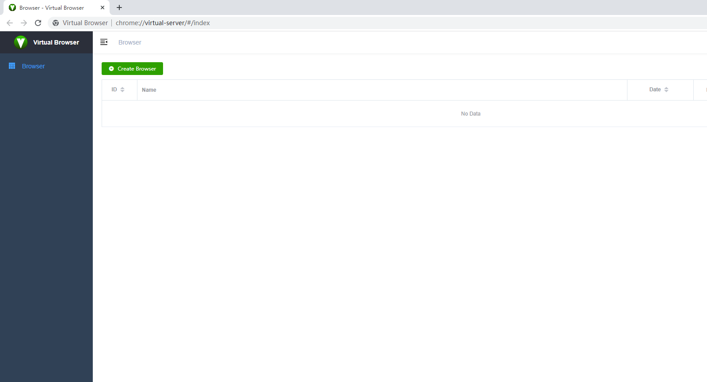
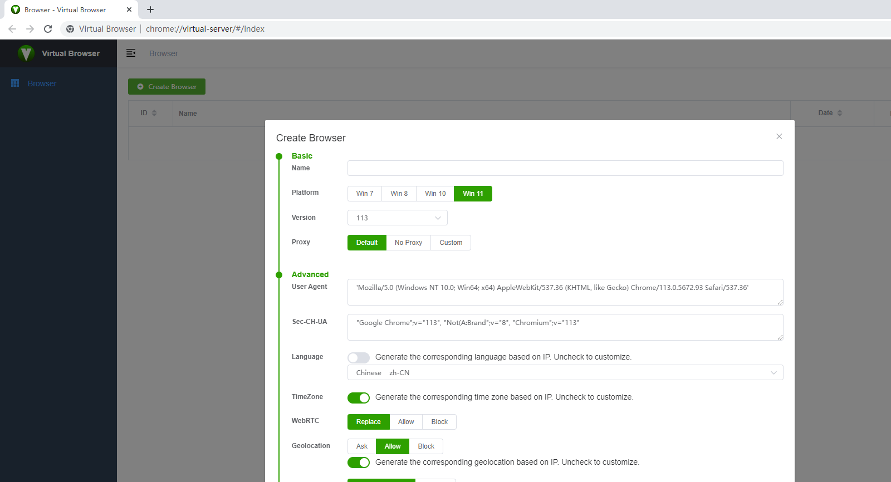
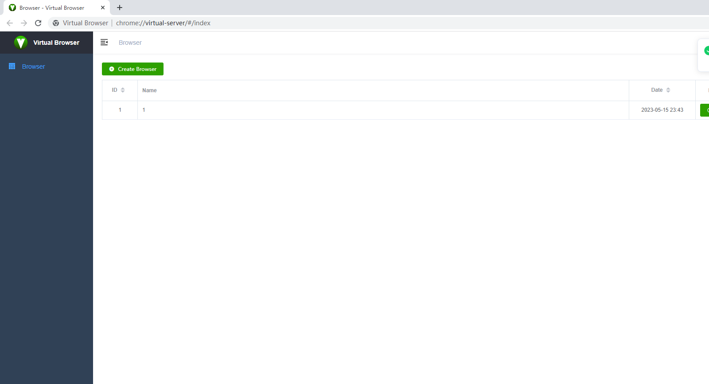
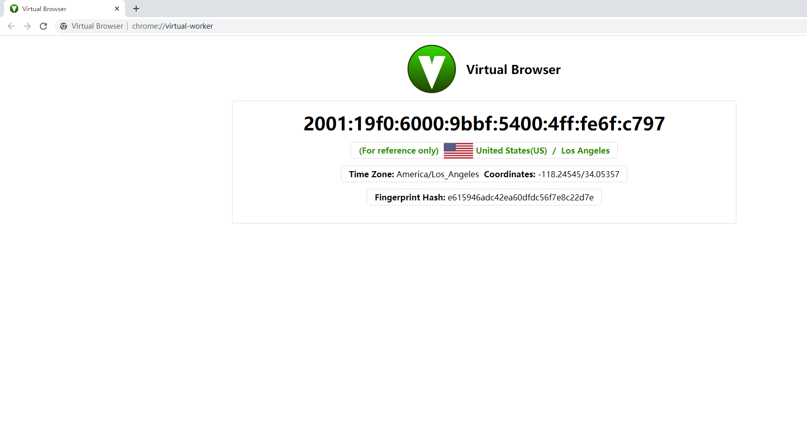

  

<b><a href="README.md">简体中文</a> | <a href="README_EN.md">English</a></b>

# VirtualBrowser

VirtualBrowser is a fingerprint browser built on [Chromium](https://www.chromium.org/). It supports Windows, macOS, and Linux and lets you create and manage multiple isolated browser profiles on a single machine.

**Browser fingerprinting** collects signals from the browser, OS, and hardware (User-Agent, language, resolution, fonts, Canvas/WebGL noise, and more) to build a digital signature that can identify or link users. VirtualBrowser helps you isolate fingerprints per profile and reduce cross-account correlation and tracking—when used lawfully and responsibly.

## Features

- **Multi-profile isolation**: Run many independent fingerprint environments on one machine
- **Centralized management**: Create, launch, edit, and remove environments from one place
- **Broad fingerprint coverage**: UA, proxy, language/timezone, WebRTC, geolocation, Canvas/WebGL, AudioContext, and more (see table below)
- **Automation-ready**: Works with Playwright and other Chromium automation tools; see [automation](automation/)

## Quick Start

### Install

Download the latest build from [Releases](https://github.com/Virtual-Browser/VirtualBrowser/releases) or the official site: [virtualbrowser.cc](https://virtualbrowser.cc) · [vbbrowser.com](https://www.vbbrowser.com/)

### Create a profile

1. Open VirtualBrowser and click **Create Browser**
   
2. Adjust settings in the dialog or keep the defaults
   
   

### Launch a profile

1. Click **Start** on the profile you created
2. The new window runs with that profile’s isolated fingerprint

## Fingerprint capabilities

Verify changes with [FingerprintJS](https://fingerprintjs.github.io/fingerprintjs/) and [BrowserLeaks](https://browserleaks.com/).

| Category                                                          | Description                                                           |
| ----------------------------------------------------------------- | --------------------------------------------------------------------- |
| OS / browser version                                              | Edit the corresponding fields in `userAgent`                          |
| Proxy                                                             | Default, no proxy, or custom                                          |
| Language                                                          | `navigator.language` / `navigator.languages`; optional IP-based match |
| Timezone                                                          | `Date` timezone; optional IP-based match                              |
| WebRTC                                                            | Leak-related settings                                                 |
| Geolocation                                                       | `navigator.geolocation`; optional IP-based match                      |
| Resolution                                                        | `screen.width` / `screen.height`                                      |
| Fonts                                                             | Randomize the available font list                                     |
| Canvas / WebGL                                                    | Drawing noise for 2D and WebGL                                        |
| WebGL metadata                                                    | Vendor, renderer, etc.                                                |
| AudioContext                                                      | Noise on `getChannelData` / `getFloatFrequencyData`                   |
| ClientRects / Speech Voices                                       | Related API hardening                                                 |
| CPU / memory                                                      | e.g. `hardwareConcurrency`                                            |
| Device name / MAC                                                 | Device identifier fields                                              |
| Do Not Track / SSL / port-scan protection / hardware acceleration | Additional privacy and network options                                |

## Automation

Because VirtualBrowser is Chromium-based, you can use [Playwright](https://playwright.dev/) or other Chromium automation stacks. Sample code and setup notes live in the [automation](automation/) folder.

## Support and contribute

The project is still evolving. You can help by:

1. **Code**: Open PRs for bug fixes, features, or docs
2. **Compatibility**: Install, visit your usual sites, and report what breaks
3. **Feedback**: Share ideas to improve UX and functionality
4. **Spread the word**: Post about your experience on social media
5. **Community**: Join discussions with users and developers (see Contact below)

## Disclaimer

VirtualBrowser is provided for technical exchange, learning, and research only. Do not use this project for illegal purposes or harmful activity. The authors are not liable for damage to others or systems caused by use of this software.

By using this project, you agree not to use its technology for unlawful acts, rights violations, or system attacks. Any accidents, losses, or damages (including data loss, property loss, or legal liability) from using this technology are not the responsibility of the project authors.

The information here is for learning and reference only and is not a warranty of any kind. The authors make no claims about accuracy, fitness, or applicability.

## Contact

- Email: [virtual.browser.2020@gmail.com](mailto:virtual.browser.2020@gmail.com)
- Website: [virtualbrowser.cc](https://virtualbrowser.cc) · [vbbrowser.com](https://www.vbbrowser.com/)
- QQ group: `564142956`

## Acknowledgments

- [FingerprintJS](https://fingerprintjs.github.io/fingerprintjs/)
- [BrowserLeaks](https://browserleaks.com/)
- [Chromium](https://www.chromium.org/)
- [vue-element-admin](https://github.com/PanJiaChen/vue-element-admin)
